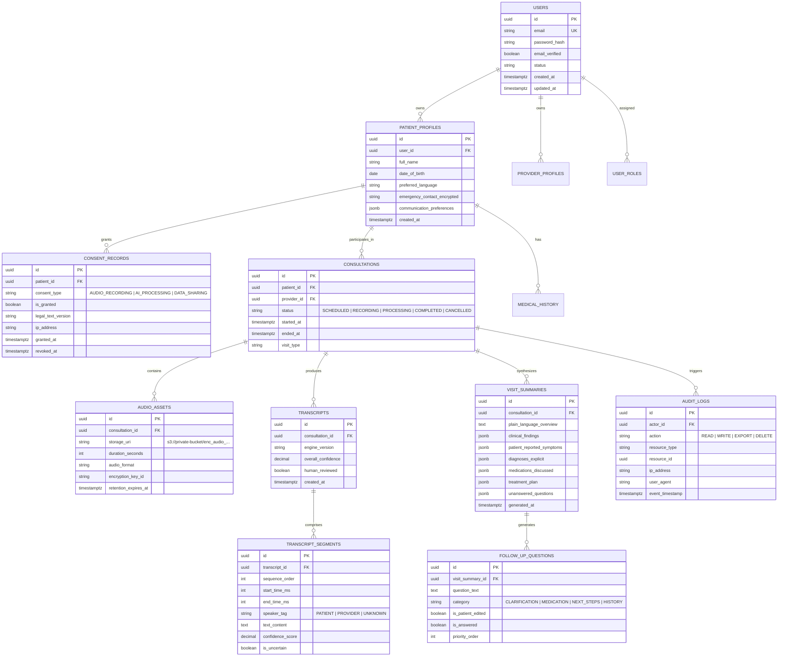
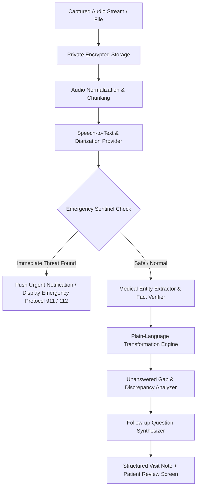
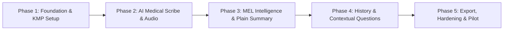

# MEL – Medical Empowerment Liaison
## Comprehensive System Architecture & Project Blueprint

**Version:** 1.0.0-PROD  
**Target Markets:** United States (HIPAA/HITECH), Europe (GDPR, EU AI Act, MDR 2017/745 considerations)  
**Platforms:** Android, iOS (Shared Kotlin Multiplatform / Compose Multiplatform Core) + Modular Backend (FastAPI / Ktor)

---

## 1. Executive Summary & Product Vision

**MEL (Medical Empowerment Liaison)** is an AI-powered healthcare communication, medical scribe, and patient advocacy platform. Its primary purpose is to empower patients to understand what occurred during their healthcare appointments, eliminate clinical ambiguities, preserve patient concerns, and construct actionable, respectful follow-up questions for healthcare providers.

### Core Guiding Principles:
1. **Communication & Education Assistant, Not a Diagnostic Device:** MEL does not formulate diagnoses, alter prescription regimens, or substitute qualified medical judgment.
2. **Patient Voice Preservation:** Direct statements from patients are preserved verbatim and visually distinguished from provider clinical notes and AI synthesized explanations.
3. **Clinical Fact vs. AI Inference Distinction:** Clinical claims strictly trace back to source audio/transcript segments with explicit certainty markers. Unstated elements are flagged as "Not established in visit."
4. **Zero-Trust Security by Design:** Strict segregation of raw audio, transcripts, and structured medical records; end-to-end encryption in transit (TLS 1.3) and at rest (AES-256-GCM); tenant/patient row-level database authorization.

---

## 2. High-Level Architecture Overview

```
┌─────────────────────────────────────────────────────────────────────────────┐
│                           MEL Mobile Client (KMP)                           │
│                                                                             │
│  ┌───────────────────────────────────────────────────────────────────────┐  │
│  │                    Presentation Layer (Compose Multiplatform)         │  │
│  │   Auth | Onboarding | Scribe / Audio | Visit Summary | Follow-up Qs   │  │
│  └───────────────────────────────────┬───────────────────────────────────┘  │
│                                      │                                      │
│  ┌───────────────────────────────────▼───────────────────────────────────┐  │
│  │            Domain Layer (Clean Architecture / Pure Kotlin)            │  │
│  │   UseCases | Domain Models | Repository Interfaces | Business Logic   │  │
│  └───────────────────────────────────┬───────────────────────────────────┘  │
│                                      │                                      │
│  ┌───────────────────────────────────▼───────────────────────────────────┐  │
│  │                        Data Layer & Native Bridges                    │  │
│  │   Ktor HTTP Client | SQLDelight Local Cache | Platform Keyring/Crypto │  │
│  │   Android: MediaRecorder / AudioRecord  │  iOS: AVAudioEngine Bridge  │  │
│  └───────────────────────────────────┬───────────────────────────────────┘  │
└──────────────────────────────────────┼──────────────────────────────────────┘
                                       │ HTTPS (TLS 1.3) / WSS
                                       ▼
┌─────────────────────────────────────────────────────────────────────────────┐
│                       MEL Backend API & Orchestration                       │
│  ┌───────────────────────────────────────────────────────────────────────┐  │
│  │                     API Gateway & Security Layer                      │  │
│  │   OIDC Auth (JWT/PASETO) | Rate Limiter | Role-Based Access Control   │  │
│  └───────────────────────────────────┬───────────────────────────────────┘  │
│                                      │                                      │
│  ┌───────────────────────────────────▼───────────────────────────────────┐  │
│  │                     Core Healthcare Services                          │  │
│  │  - Auth & Profile Service       - Consent Management Service          │  │
│  │  - Consultation Service         - Medical History Engine              │  │
│  │  - Audit Logging Service        - Emergency Triage Sentinel           │  │
│  └───────────────────────────────────┬───────────────────────────────────┘  │
│                                      │ Asynchronous Events / Job Queue      │
│  ┌───────────────────────────────────▼───────────────────────────────────┐  │
│  │                      AI Scribe & Intelligence Worker                  │  │
│  │  - Pluggable Speech-to-Text (STT) Service + Diarization               │  │
│  │  - Medical Named Entity Recognition (NER)                             │  │
│  │  - Plain-Language Synthesis & Summary Engine                          │  │
│  │  - Unanswered Question & Empowerment Analysis                         │  │
│  └───────────────────┬───────────────────────────────┬───────────────────┘  │
└──────────────────────┼───────────────────────────────┼──────────────────────┘
                       ▼                               ▼
       ┌───────────────────────────────┐  ┌─────────────────────────────────┐
       │   PostgreSQL (RDS / Cloud)    │  │ Encrypted Private Object Storage│
       │ - Normalized Relational Data  │  │ - Audio Blobs (Encrypted)       │
       │ - Row-Level Security (RLS)    │  │ - Generated Clinical PDFs       │
       │ - Immutable Audit Trail       │  │ - Ephemeral Processing Files    │
       └───────────────────────────────┘  └─────────────────────────────────┘
```

---

## 3. Technology Stack Recommendations

| Component | Recommended Technology | Justification |
| :--- | :--- | :--- |
| **Mobile Core** | Kotlin Multiplatform (KMP) | Shared business logic, networking, database, and domain validation. |
| **Mobile UI** | Compose Multiplatform (CMP) | Single declarative UI codebase across Android and iOS; 100% native performance. |
| **Mobile Concurrency** | Kotlin Coroutines & Flow | Reactive, thread-safe asynchronous streams for audio processing and UI state. |
| **Mobile Networking** | Ktor Client (Engine: OkHttp on Android, Darwin on iOS) | Lightweight, multiplatform-native HTTP client with full TLS pinning support. |
| **Local Database** | SQLDelight / Room KMP (with SQLCipher) | Type-safe multiplatform SQL database with encrypted database support. |
| **Platform Audio** | Android `AudioRecord` / iOS `AVAudioEngine` | High-fidelity 16kHz/48kHz linear PCM audio capture; resilient background recording. |
| **Backend Framework** | Python FastAPI or Kotlin Ktor | FastAPI offers rapid integration with AI/ML pipelines (PyTorch, Whisper, LangChain); Ktor gives end-to-end Kotlin type safety. Recommended: **FastAPI backend with Celery/Redis** or **Kotlin Ktor with modular microservices**. |
| **Database** | PostgreSQL 16+ | ACID compliance, JSONB support for clinical entities, and Row Level Security (RLS). |
| **Object Storage** | AWS S3 / Google Cloud Storage with SSE-KMS | Patient audio and exported PDF storage encrypted with customer-managed keys. |
| **AI / STT Pipeline** | Pluggable Provider Interface (AWS Transcribe Medical / Deepgram Medical / Whisper v3 + LLM Orchestration) | Decoupled architecture allowing vendor swapping without breaking mobile API contracts. |

---

## 4. Mobile Clean Architecture & Module Design

MEL adopts a strict **Clean Architecture** with unidirectional data flow (MVI/MVVM).

### Presentation Layer
- **Compose Multiplatform UI Components**: Atomic, reusable widgets complying with WCAG 2.1 AA accessibility standards (min 48dp touch targets, dynamic typography, high-contrast modes).
- **ViewModels**: Expose immutable `StateFlow<UiState>` and consume `UiIntent` events.

### Domain Layer (Pure Kotlin - 0 Android/iOS dependencies)
- **Entities**: Pure business models (`Consultation`, `TranscriptSegment`, `VisitSummary`, `FollowUpQuestion`).
- **Use Cases**: Single-responsibility interactors (`StartConsultationUseCase`, `ProcessAudioRecordingUseCase`, `GenerateSummaryUseCase`, `DetectEmergencyKeywordsUseCase`).
- **Repository Interfaces**: Abstract boundary contracts implemented by the Data layer.

### Data Layer
- **Repository Implementations**: Coordinates between local cache (SQLDelight) and remote REST/WebSocket APIs (Ktor).
- **Data Transfer Objects (DTOs)**: Serialized with `kotlinx.serialization`.
- **Data Mappers**: Bi-directional transformation between network DTOs and Domain Entities.

---

## 5. Directory & File Structure (Complete Project Blueprint)

```
Mel_Medical_App/
├── .github/
│   └── workflows/
│       ├── android-ci.yml
│       ├── ios-ci.yml
│       └── backend-ci.yml
├── docs/
│   ├── ARCHITECTURE.md
│   ├── SECURITY_HIPAA_GDPR.md
│   ├── API_SPECIFICATION.md
│   └── DATABASE_ERD.md
├── build.gradle.kts
├── settings.gradle.kts
├── gradle.properties
│
├── composeApp/                                # Kotlin Multiplatform Shared Mobile Module
│   ├── build.gradle.kts
│   ├── src/
│   │   ├── commonMain/                        # Shared Kotlin Code (Android + iOS)
│   │   │   ├── kotlin/com/mel/app/
│   │   │   │   ├── App.kt                     # Application entry point & screen host
│   │   │   │   ├── di/                        # Dependency Injection (Koin)
│   │   │   │   │   ├── CommonModule.kt
│   │   │   │   │   ├── NetworkModule.kt
│   │   │   │   │   ├── DatabaseModule.kt
│   │   │   │   │   └── ViewModelModule.kt
│   │   │   │   │
│   │   │   │   ├── core/                      # Cross-cutting primitives
│   │   │   │   │   ├── error/
│   │   │   │   │   │   ├── AppError.kt
│   │   │   │   │   │   └── ErrorHandler.kt
│   │   │   │   │   ├── result/
│   │   │   │   │   │   └── NetworkResult.kt
│   │   │   │   │   ├── security/
│   │   │   │   │   │   └── SecureStorage.kt # expect interface
│   │   │   │   │   └── emergency/
│   │   │   │   │       └── EmergencyDetector.kt # Client-side immediate sentinel
│   │   │   │   │
│   │   │   │   ├── domain/                    # Clean Architecture: Pure Business Domain
│   │   │   │   │   ├── model/
│   │   │   │   │   │   ├── User.kt
│   │   │   │   │   │   ├── PatientProfile.kt
│   │   │   │   │   │   ├── ConsentRecord.kt
│   │   │   │   │   │   ├── Consultation.kt
│   │   │   │   │   │   ├── TranscriptSegment.kt
│   │   │   │   │   │   ├── VisitSummary.kt
│   │   │   │   │   │   ├── FollowUpQuestion.kt
│   │   │   │   │   │   └── MedicalHistoryItem.kt
│   │   │   │   │   ├── repository/
│   │   │   │   │   │   ├── AuthRepository.kt
│   │   │   │   │   │   ├── ConsentRepository.kt
│   │   │   │   │   │   ├── ConsultationRepository.kt
│   │   │   │   │   │   ├── AudioRecordRepository.kt
│   │   │   │   │   │   └── SummaryRepository.kt
│   │   │   │   │   └── usecase/
│   │   │   │   │       ├── auth/
│   │   │   │   │       │   ├── LoginUseCase.kt
│   │   │   │   │       │   └── RegisterPatientUseCase.kt
│   │   │   │   │       ├── consultation/
│   │   │   │   │       │   ├── StartConsultationUseCase.kt
│   │   │   │   │       │   ├── UploadAudioUseCase.kt
│   │   │   │   │       │   └── GetConsultationDetailUseCase.kt
│   │   │   │   │       ├── scribe/
│   │   │   │   │       │   ├── RecordAudioUseCase.kt
│   │   │   │   │       │   └── StreamAudioChunkUseCase.kt
│   │   │   │   │       └── summary/
│   │   │   │   │           ├── GetVisitSummaryUseCase.kt
│   │   │   │   │           └── UpdateFollowUpQuestionUseCase.kt
│   │   │   │   │
│   │   │   │   ├── data/                      # Clean Architecture: Data Layer
│   │   │   │   │   ├── remote/                # Ktor Network Client
│   │   │   │   │   │   ├── KtorClientFactory.kt
│   │   │   │   │   │   ├── api/
│   │   │   │   │   │   │   ├── AuthApi.kt
│   │   │   │   │   │   │   ├── ConsultationApi.kt
│   │   │   │   │   │   │   └── SummaryApi.kt
│   │   │   │   │   │   └── dto/
│   │   │   │   │   │       ├── AuthDtos.kt
│   │   │   │   │   │       ├── ConsultationDtos.kt
│   │   │   │   │   │       └── SummaryDtos.kt
│   │   │   │   │   ├── local/                 # SQLDelight Local Storage
│   │   │   │   │   │   ├── DatabaseDriverFactory.kt # expect interface
│   │   │   │   │   │   └── dao/
│   │   │   │   │   │       ├── ConsultationDao.kt
│   │   │   │   │   │       └── SummaryDao.kt
│   │   │   │   │   └── repository/            # Concrete Repositories
│   │   │   │   │       ├── AuthRepositoryImpl.kt
│   │   │   │   │       ├── ConsultationRepositoryImpl.kt
│   │   │   │   │       └── SummaryRepositoryImpl.kt
│   │   │   │   │
│   │   │   │   ├── presentation/              # Compose Multiplatform UI
│   │   │   │   │   ├── theme/
│   │   │   │   │   │   ├── Color.kt           # Calm, trustworthy medical palette
│   │   │   │   │   │   ├── Typography.kt      # Accessible font scales
│   │   │   │   │   │   ├── Shape.kt
│   │   │   │   │   │   └── Theme.kt
│   │   │   │   │   ├── navigation/
│   │   │   │   │   │   ├── Screen.kt
│   │   │   │   │   │   └── NavigationRoot.kt
│   │   │   │   │   ├── components/            # Design System Components
│   │   │   │   │   │   ├── MelTopBar.kt
│   │   │   │   │   │   ├── MelButton.kt
│   │   │   │   │   │   ├── AudioVisualizer.kt
│   │   │   │   │   │   ├── EmergencyBanner.kt
│   │   │   │   │   │   └── ClinicalCard.kt
│   │   │   │   │   └── screens/
│   │   │   │   │       ├── auth/
│   │   │   │   │       │   ├── LoginScreen.kt
│   │   │   │   │       │   ├── RegisterScreen.kt
│   │   │   │   │       │   └── AuthViewModel.kt
│   │   │   │   │       ├── onboarding/
│   │   │   │   │       │   ├── ConsentExplanationScreen.kt
│   │   │   │   │       │   └── OnboardingViewModel.kt
│   │   │   │   │       ├── dashboard/
│   │   │   │   │       │   ├── DashboardScreen.kt
│   │   │   │   │       │   └── DashboardViewModel.kt
│   │   │   │   │       ├── scribe/            # Major MVP Recording Screen
│   │   │   │   │       │   ├── ScribeRecordingScreen.kt
│   │   │   │   │       │   ├── ConsentVerificationDialog.kt
│   │   │   │   │       │   └── ScribeViewModel.kt
│   │   │   │   │       ├── summary/            # AI Visit Summary Screen
│   │   │   │   │       │   ├── VisitSummaryScreen.kt
│   │   │   │   │       │   └── VisitSummaryViewModel.kt
│   │   │   │   │       └── questions/          # AI Follow-up Questions Screen
│   │   │   │   │           ├── FollowUpQuestionsScreen.kt
│   │   │   │   │           └── QuestionsViewModel.kt
│   │   │   │   │
│   │   │   │   └── platform/                  # expect audio recorder & platform tools
│   │   │   │       ├── AudioRecorder.kt       # expect interface
│   │   │   │       └── PlatformInfo.kt
│   │   │   └── sqldelight/com/mel/app/database/
│   │   │       └── MelDatabase.sq
│   │   │
│   │   ├── androidMain/                       # Android Target Implementations
│   │   │   ├── kotlin/com/mel/app/
│   │   │   │   ├── MainActivity.kt
│   │   │   │   ├── MelApplication.kt
│   │   │   │   └── platform/
│   │   │   │       ├── AndroidAudioRecorder.kt     # actual implementation (AudioRecord)
│   │   │   │       ├── AndroidSecureStorage.kt     # EncryptedSharedPreferences
│   │   │   │       └── AndroidDatabaseDriverFactory.kt
│   │   │   └── AndroidManifest.xml
│   │   │
│   │   └── iosMain/                           # iOS Target Implementations
│   │       └── kotlin/com/mel/app/
│   │           ├── MainViewController.kt
│   │           └── platform/
│   │               ├── IosAudioRecorder.kt         # actual implementation (AVAudioEngine)
│   │               ├── IosSecureStorage.kt         # iOS Keychain wrapper
│   │               └── IosDatabaseDriverFactory.kt
│   │
│   └── src/commonTest/                        # Cross-Platform Unit Tests
│       └── kotlin/com/mel/app/
│           ├── domain/EmergencyDetectorTest.kt
│           ├── domain/StartConsultationUseCaseTest.kt
│           └── presentation/ScribeViewModelTest.kt
│
├── iosApp/                                    # iOS Xcode Project Container
│   ├── iosApp/
│   │   ├── iOSApp.swift                       # SwiftUI App Wrapper hosting CMP
│   │   ├── Info.plist                         # Microphones Privacy Keys (NSMicrophoneUsageDescription)
│   │   └── Assets.xcassets
│   └── iosApp.xcodeproj
│
└── backend/                                   # Standalone Production Backend Service
    ├── Dockerfile
    ├── docker-compose.yml
    ├── pyproject.toml / requirements.txt      # (or build.gradle.kts if Ktor backend)
    ├── migrations/                            # Alembic / Flyway SQL Migrations
    │   ├── V1__init_schema.sql
    │   └── V2__add_audit_and_rls.sql
    └── src/
        ├── core/
        │   ├── config.py
        │   ├── security.py                    # JWT, TLS, and crypto primitives
        │   ├── audit.py                       # Immutable HIPAA audit logger
        │   └── database.py                    # Connection pooling & sessions
        ├── models/                            # ORM & Schema entities
        │   ├── user.py
        │   ├── consultation.py
        │   ├── transcript.py
        │   └── summary.py
        ├── api/v1/                            # Versioned REST APIs
        │   ├── auth_router.py
        │   ├── consultation_router.py
        │   ├── audio_router.py
        │   ├── summary_router.py
        │   └── question_router.py
        └── services/ai/                       # Decoupled AI Pipeline Providers
            ├── speech_to_text.py              # Interface + Whisper/Transcribe Provider
            ├── diarization.py                 # Speaker separation interface
            ├── clinical_extractor.py          # Medical entity & fact extraction
            ├── summary_generator.py           # Patient-friendly summary synthesis
            └── question_generator.py          # Empowerment intelligence questions
```

---

## 6. Database ER Model & Schema Design

MEL leverages a strictly normalized PostgreSQL architecture with patient-scoped access controls and explicit segregation of raw multimedia from derived health intelligence.



---

## 7. Versioned REST API Contracts (OpenAPI Spec Blueprint)

### A. Authentication & Consent
- `POST /api/v1/auth/register` – Register patient credentials (MFA setup).
- `POST /api/v1/auth/login` – Authenticate & return short-lived JWT + secure refresh token.
- `POST /api/v1/consent/record` – Store immutable patient consent records (audio capture & AI processing).

### B. Consultations & AI Scribe Pipeline
- `POST /api/v1/consultations` – Initiate consultation session.
- `POST /api/v1/consultations/{id}/audio/upload-url` – Generate presigned, short-lived S3 upload URL.
- `POST /api/v1/consultations/{id}/audio/complete` – Triggers transcription and diarization worker.
- `GET /api/v1/consultations/{id}/transcript` – Retrieve transcript segments with speaker tags and certainty scores.
- `PUT /api/v1/consultations/{id}/transcript/segments/{seg_id}` – Edit/correct transcription segments.

### C. Medical Intelligence & Empowerment
- `POST /api/v1/consultations/{id}/summaries/generate` – Trigger AI synthesis pipeline.
- `GET /api/v1/consultations/{id}/summary` – Retrieve structured plain-language visit summary.
- `GET /api/v1/consultations/{id}/questions` – Retrieve AI-generated follow-up questions.
- `POST /api/v1/consultations/{id}/questions` – Add patient-defined custom question.
- `PATCH /api/v1/consultations/{id}/questions/{q_id}` – Mark answered or edit wording.
- `POST /api/v1/consultations/{id}/export/pdf` – Export patient-approved summary with verifiable cryptographic signature.

---

## 8. AI Engineering & Decoupled Processing Pipeline

To guarantee vendor independence, all AI operations are driven through provider-agnostic interfaces:



### Pluggable Interfaces (Domain Contracts):
```kotlin
interface SpeechToTextEngine {
    suspend fun transcribeAudio(audioBytes: ByteArray, language: String): Result<RawTranscript>
}

interface SpeakerDiarizationEngine {
    suspend fun diarizeSpeakers(audioBytes: ByteArray, transcript: RawTranscript): Result<List<DiarizedSegment>>
}

interface ClinicalIntelligenceEngine {
    suspend fun extractClinicalEntities(transcript: List<DiarizedSegment>): Result<ClinicalEntities>
    suspend fun generatePlainLanguageSummary(entities: ClinicalEntities, patientHistory: PatientHistoryContext?): Result<VisitSummary>
    suspend fun generateFollowUpQuestions(summary: VisitSummary, history: PatientHistoryContext?): Result<List<FollowUpQuestion>>
}
```

---

## 9. Security, Privacy & Regulatory Compliance Blueprint

### HIPAA Compliance (United States)
- **BAA Execution:** Every upstream cloud vendor (AWS, GCP, transcription APIs, LLM inference endpoints) must have an executed Business Associate Agreement.
- **Access Controls & Encryption:** Zero direct public database exposure; AES-256 at rest, TLS 1.3 in transit with Certificate Pinning enabled on mobile clients.
- **Audit Trails:** Immutable, append-only audit records for all PHI reads, exports, and modifications.
- **De-Identification:** Audio and transcript segments scrubbed of indirect identifiers before indexing.

### GDPR Compliance (Europe - Art. 9 Health Data)
- **Lawful Basis:** Explicit consent (GDPR Art. 6(1)(a) & Art. 9(2)(a)) collected with explicit opt-ins before audio capture starts.
- **Right to Erasure (Art. 17):** Cascading, cryptographic deletion of audio recordings, transcripts, and generated summaries upon patient request.
- **Data Minimization:** No storage of audio beyond the authorized retention duration set by the patient.

### Clinical Safety & Emergency Triage
- Immediate local regex and fast keyword detection running directly on the mobile device for critical symptoms (e.g., severe chest pain, stroke symptoms, acute dyspnea). If triggered, an immediate **Emergency Warning Banner** redirects the user to **911 (US)** or **112 (EU)** before waiting for server-side AI processing.

---

## 10. Phased MVP Implementation Roadmap



- **Phase 1: Foundation (Weeks 1–2):** KMP multiplatform repository layout, SQLDelight local database, Ktor client, backend API gateway, PostgreSQL schema, JWT authentication, and patient onboarding flow.
- **Phase 2: AI Medical Scribe (Weeks 3–5):** Platform-native audio recording (`AudioRecord` on Android, `AVAudioEngine` on iOS), consent workflow modal, secure upload to object store, STT engine integration, diarization, and editable transcript view.
- **Phase 3: MEL Intelligence (Weeks 6–8):** Medical entity extraction, structured summary synthesis, plain-language clinical translation, unanswered question identification.
- **Phase 4: Patient History & Empowerment (Weeks 9–10):** Historical consultation timeline, cross-visit trend detection, dynamic follow-up question refinement.
- **Phase 5: Production Readiness & Hardening (Weeks 11–12):** PDF export with cryptographic signing, role-based audit verification, synthetic scenario validation (Scenario 01 & 02), accessibility review (WCAG 2.1 AA), end-to-end integration tests.

---
*Document produced as authoritative blueprint for the MEL platform implementation.*

